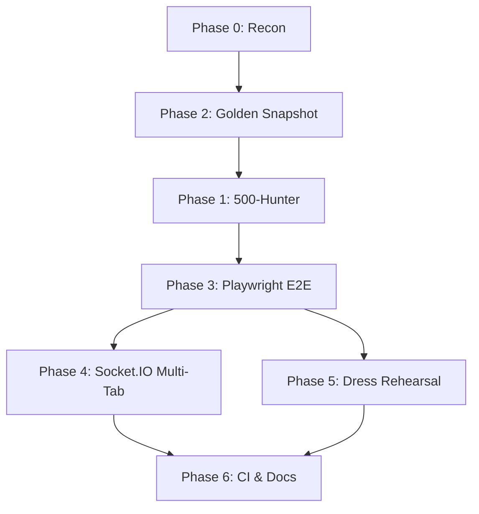

# PRE-DEMO QA KICKOFF — DeepSeek v4.1 Flash Execution Plan

> **Mission**: Build a 5-stage automated verification funnel so a solo founder can demo Wolf HMS to hospital decision-makers with mathematical confidence instead of hope.
>
> **Architect & Final Gatekeeper**: Gemini 4 Argon
> **High-Velocity Executor**: DeepSeek v4.1 Flash
> **Verification & Test Runner**: Kimi K3
> **Operating model**: Architect writes brief → Flash executes → Kimi K3 independently verifies. Flash never self-certifies.

---

## Context (Read First)

- Wolf HMS production: VPS `185.213.27.158`, PM2 `wolf-hms-api` on port 5002, entry `server/server-cloud.js`
- Nginx serves `client/dist` at `/var/www/wolf-hms/client/dist`, proxies `/wolf/api/` → PM2
- Demo tenant: `hospital_id = 1`, DB `wolf_hms_prod` in Docker `wolf_fitness_db`
- Route matrix: **517 matched / 20 broken** (all 20 = intentionally-disabled Bucket C)
- **5 known Bucket B endpoints return 500 on prod** (missing schema):
  - `pending_charges.hospital_id`
  - anaesthesia `hospital_id`
  - preauth `patient_number`
  - pac `start_time`
  - `pacu_beds` table
- Bundle size: `index-BloG960q.js` ≈ 7.6 MB
- Existing test harness: 193 backend tests green, 16 frontend tests green, **zero E2E coverage**
- Existing load tests: k6 only ([`loadtests/k6/`](../../loadtests/k6/)) — no browser automation
- Playwright: **NOT installed** in [`client/package.json`](../../client/package.json)
- No `seed-demo-hospital.sql` exists — only legacy debug endpoint in [`phase2_backups/server-cloud.js`](../../phase2_backups/server-cloud.js)
- DB access: `server/scripts/admin-cli.js` via SSH with `MIGRATION_CLI_TOKEN` (see [`.agents/skills/database-ops/SKILL.md`](../../.agents/skills/database-ops/SKILL.md))
- **SSH from Windows is broken** — use Node `ssh2` library with password auth
- **Contract-First Rule**: never apply fallbacks without verifying exact frontend payload keys (see [`memory-bank/systemPatterns.md`](../../memory-bank/systemPatterns.md))
- **PK types**: `patients.id`=UUID, `admissions.id`=UUID, `hospitals.id`=INTEGER, `users.id`=INTEGER

---

## Phase 0 — Recon & Baseline (READ-ONLY, no mutations)

**Goal**: Establish ground truth before writing any code.

| #   | Task                                                                           | Output                                                                              |
| --- | ------------------------------------------------------------------------------ | ----------------------------------------------------------------------------------- |
| 0.1 | Re-run route matrix audit locally: `node scripts/audit/route-matrix.js`        | Confirm 517/20 split still holds                                                    |
| 0.2 | Run existing API probe: `node scripts/api_probe.js` against local dev server   | Refresh [`scripts/api_probe_report.md`](../../scripts/api_probe_report.md) baseline |
| 0.3 | Inventory all Bucket A + Bucket B mounted routes from `server/server-cloud.js` | Produce `plans/bucket_ab_routes.json` — flat list of `{method, path, authRequired}` |
| 0.4 | Verify the 5 known prod 500s reproduce locally against prod-like schema        | Document in `plans/bucket_b_500s.md` with exact SQL error text                      |
| 0.5 | Confirm `server/scripts/admin-cli.js` works locally with `--dry-run`           | Log output to `plans/admin_cli_smoke.log`                                           |

**Acceptance**: All 5 outputs committed to `plans/` directory. Zero code changes.

---

## Phase 1 — Authenticated 500-Hunter Crawler

**Goal**: Catch hidden SQL and UUID-vs-INTEGER crashes before opening a browser.

| #   | Task                              | Details                                                                                                                                          |
| --- | --------------------------------- | ------------------------------------------------------------------------------------------------------------------------------------------------ |
| 1.1 | Create `scripts/qa/500-hunter.js` | Node.js script, read-only, uses `axios`                                                                                                          |
| 1.2 | Auth flow                         | Login via `POST /api/auth/login` with demo admin creds from `server/.env`, store JWT                                                             |
| 1.3 | Target list                       | Consume `plans/bucket_ab_routes.json` from Phase 0.3 — only `GET` endpoints, only Bucket A + B                                                   |
| 1.4 | Request execution                 | Fire each `GET` with `Authorization: Bearer <jwt>` and `X-Hospital-ID: 1`, 5s timeout, sequential (not parallel — avoid overwhelming dev server) |
| 1.5 | Response classification           | `200` = pass, `401/403` = auth issue (flag), `404` = route missing (flag), `500` = **CRITICAL** (capture full error body + stack)                |
| 1.6 | UUID-vs-INTEGER detector          | Regex-scan 500 response bodies for `invalid input syntax for type uuid` or `operator does not exist: uuid = integer` — tag as `UUID_MISMATCH`    |
| 1.7 | Missing-column detector           | Regex-scan for `column .* does not exist` — tag as `SCHEMA_GAP`                                                                                  |
| 1.8 | Output                            | Write `scripts/qa/500-hunter-report.json` with `{timestamp, total, passed, failed, critical: [{route, status, error, tag}]}`                     |
| 1.9 | Markdown summary                  | Write `scripts/qa/500-hunter-report.md` — human-readable table sorted by severity                                                                |

**Acceptance**:

- Script runs clean against local dev server
- Report identifies the 5 known Bucket B 500s (from Phase 0.4) as `SCHEMA_GAP`
- Zero false positives on the 17 known-passing endpoints from [`scripts/api_probe_report.md`](../../scripts/api_probe_report.md)
- `node scripts/qa/500-hunter.js` exits 0 if no 500s, exits 1 if any 500 found (CI-ready)

---

## Phase 2 — Golden Hospital Demo Snapshot

**Goal**: Deterministic, realistic demo data that resets in 5 seconds.

| #    | Task                                             | Details                                                                                                                         |
| ---- | ------------------------------------------------ | ------------------------------------------------------------------------------------------------------------------------------- |
| 2.1  | Create `server/scripts/seed-demo-hospital.sql`   | Idempotent SQL — `DELETE` + `INSERT` or `ON CONFLICT DO UPDATE`                                                                 |
| 2.2  | Seed 15 realistic Indian patients                | Mix of names (Priya Sharma, Rajesh Kumar, Fatima Sheikh, etc.), realistic ages, Indian phone numbers, ABHA IDs where applicable |
| 2.3  | OPD & Triage cohort (4 patients)                 | Status `Waiting`, chief complaints populated, ready for AI Symptom Analysis                                                     |
| 2.4  | Clinical & AI Safety cohort (1 patient)          | Active medications include Warfarin + Aspirin — prescribing Ciprofloxacin must trigger Drug Interaction Checker                 |
| 2.5  | Diagnostics cohort (4 patients)                  | 2 pending lab orders (CBC, LFT), 1 completed lab with report, 1 pending radiology (Chest X-ray)                                 |
| 2.6  | IPD & ICU cohort (3 patients)                    | Status `Admitted`, vitals history (last 24h, 1h intervals), pending pharmacy billing items                                      |
| 2.7  | Emergency cohort (1 patient)                     | 1 resolved emergency event (Code Blue, resolved 2h ago) — proves emergency system works without leaving stale active alerts     |
| 2.8  | Billing cohort (2 patients)                      | 1 with paid invoice, 1 with pending invoice containing OPD + lab + pharmacy line items                                          |
| 2.9  | Wrap in transaction                              | `BEGIN; ... COMMIT;` — atomic apply                                                                                             |
| 2.10 | Create `server/scripts/seed-demo-hospital.js`    | Node wrapper: applies SQL via `pg`, verifies row counts, prints summary table                                                   |
| 2.11 | Create `server/scripts/backup-demo-snapshot.js`  | `pg_dump` the seeded state to `backups/demo_golden_YYYY-MM-DD.sql.gz`                                                           |
| 2.12 | Create `server/scripts/restore-demo-snapshot.js` | `pg_restore` from latest golden snapshot, verifies row counts post-restore                                                      |
| 2.13 | npm scripts                                      | Add to `server/package.json`: `"demo:seed"`, `"demo:backup"`, `"demo:restore"`                                                  |

**Acceptance**:

- `npm run demo:seed` completes in < 30s
- `npm run demo:backup` produces a `.sql.gz` file
- `npm run demo:restore` resets DB to golden state in < 10s
- All 15 patients visible via `GET /api/patients` with correct `hospital_id = 1`
- Drug interaction triggers when prescribing Ciprofloxacin to the Warfarin patient
- Zero `Test 123` or `Lorem ipsum` strings anywhere

---

## Phase 3 — Playwright E2E Golden Clinical Journey

**Goal**: One unbroken clinical story from reception to billing, executed headlessly.

| #    | Task                                                | Details                                                                                                                                                                                                                                                                                              |
| ---- | --------------------------------------------------- | ---------------------------------------------------------------------------------------------------------------------------------------------------------------------------------------------------------------------------------------------------------------------------------------------------- |
| 3.1  | Install Playwright                                  | `cd client && npm install -D @playwright/test` + `npx playwright install chromium`                                                                                                                                                                                                                   |
| 3.2  | Create `client/playwright.config.js`                | Base URL `http://localhost:5173` (Vite dev) or `http://localhost:5002` (prod build), headless, 1 worker, trace on failure                                                                                                                                                                            |
| 3.3  | Create `client/e2e/golden-clinical-journey.spec.js` | Master E2E suite                                                                                                                                                                                                                                                                                     |
| 3.4  | Step 1 — Reception                                  | Register new patient (verify UUID in response), book OPD slot, verify queue position                                                                                                                                                                                                                 |
| 3.5  | Step 2 — Doctor Consultation                        | Login as doctor, open patient chart, run AI Clinical Co-Pilot, prescribe 2 drugs (one must trigger interaction warning), order CBC + Chest X-ray                                                                                                                                                     |
| 3.6  | Step 3 — Lab                                        | Switch to lab dashboard, verify CBC order appears, update status to `Completed`, enter results, generate report                                                                                                                                                                                      |
| 3.7  | Step 4 — Radiology                                  | Switch to radiology dashboard, verify X-ray order, update status, generate report                                                                                                                                                                                                                    |
| 3.8  | Step 5 — Pharmacy                                   | Switch to pharmacy dashboard, verify prescription appears, dispense from `pharmacy_inventory`, verify stock decrement                                                                                                                                                                                |
| 3.9  | Step 6 — Billing                                    | Open patient invoice, verify all line items present (OPD + lab + radiology + pharmacy), verify total calculation                                                                                                                                                                                     |
| 3.10 | Zero-Error Assertion                                | `page.on('pageerror')` → fail test; `page.on('response')` → fail if status >= 500 on ANY route; fail on 400/401/403/404 for Bucket A & B routes only; **exempt** the 20 documented Bucket C routes from 404 failures (they render neutral "Module not enabled" banners); no red error toasts allowed |
| 3.11 | Auth helper                                         | `client/e2e/helpers/auth.js` — `loginAs(role)` returns authenticated page context                                                                                                                                                                                                                    |
| 3.12 | Data helper                                         | `client/e2e/helpers/demoData.js` — reads from seeded golden snapshot, provides patient UUIDs                                                                                                                                                                                                         |
| 3.13 | npm script                                          | Add to `client/package.json`: `"test:e2e": "playwright test"`                                                                                                                                                                                                                                        |

**Acceptance**:

- `npm run test:e2e` passes 10/10 consecutive runs locally
- Total runtime < 3 minutes
- Zero console errors, zero failed network requests, zero React exceptions
- Trace files generated on any failure for debugging

---

## Phase 4 — Multi-Tab Socket.IO Real-Time Verification

**Goal**: Prove real-time ward sync works under demo conditions.

| #   | Task                                    | Details                                                  |
| --- | --------------------------------------- | -------------------------------------------------------- |
| 4.1 | Create `client/e2e/socket-sync.spec.js` | Two browser contexts in same test                        |
| 4.2 | Window A — Doctor/Admin                 | Login, navigate to OPD queue or ward dashboard           |
| 4.3 | Window B — Nurse Station                | Login, navigate to ward dashboard                        |
| 4.4 | Trigger event in A                      | Advance OPD queue or trigger emergency code              |
| 4.5 | Assert in B                             | Verify update appears in < 300ms without page refresh    |
| 4.6 | Emergency broadcast test                | Trigger Code Blue in A, verify banner + siren in B       |
| 4.7 | Resolve test                            | Resolve emergency in A, verify banner clears in B        |
| 4.8 | Disconnect resilience                   | Kill network in B for 5s, restore, verify auto-reconnect |

**Acceptance**:

- All 4 scenarios pass
- Latency measurements logged to `client/e2e/results/socket-latency.json`
- p95 latency < 300ms across 10 runs

---

## Phase 5 — Demo Dress Rehearsal Automation

**Goal**: Catch Vite bundle lag and browser caching traps.

| #   | Task                                       | Details                                                                                                                                                                                                                                                                      |
| --- | ------------------------------------------ | ---------------------------------------------------------------------------------------------------------------------------------------------------------------------------------------------------------------------------------------------------------------------------- |
| 5.1 | Create `client/e2e/demo-rehearsal.spec.js` | Simulates full 10-minute pitch                                                                                                                                                                                                                                               |
| 5.2 | Network throttling                         | Playwright CDP session: `const cdp = await page.context().newCDPSession(page); await cdp.send('Network.emulateNetworkConditions', { offline: false, latency: 150, downloadThroughput: (4 * 1024 * 1024) / 8, uploadThroughput: (1.5 * 1024 * 1024) / 8 })` — Fast 4G profile |
| 5.3 | Incognito equivalent                       | Fresh browser context per run, no cache                                                                                                                                                                                                                                      |
| 5.4 | Bucket C smoke test                        | Visit `InfectionControlDashboard` and `QualityDashboard`, verify "Module not enabled" badge renders cleanly                                                                                                                                                                  |
| 5.5 | Bundle size assertion                      | Fail if `index-*.js` > 8 MB (current 7.6 MB + headroom)                                                                                                                                                                                                                      |
| 5.6 | First-contentful-paint                     | Fail if FCP > 3s on Fast 4G                                                                                                                                                                                                                                                  |
| 5.7 | Time-to-interactive                        | Fail if TTI > 8s on Fast 4G                                                                                                                                                                                                                                                  |
| 5.8 | Generate rehearsal report                  | `client/e2e/results/rehearsal-report.md` with timings, screenshots, pass/fail                                                                                                                                                                                                |

**Acceptance**:

- All performance budgets pass
- Bucket C pages render neutral badges without crashes
- Report generated automatically after each run

---

## Phase 6 — CI Integration & Documentation

**Goal**: Make the funnel repeatable and discoverable.

| #   | Task                                       | Details                                                                                        |
| --- | ------------------------------------------ | ---------------------------------------------------------------------------------------------- |
| 6.1 | Create `.github/workflows/pre-demo-qa.yml` | Runs on demand (`workflow_dispatch`), executes Phases 1–5                                      |
| 6.2 | Add root `package.json` script             | `"qa:pre-demo": "npm run qa:500-hunter && npm run demo:seed && cd client && npm run test:e2e"` |
| 6.3 | Create `docs/PRE_DEMO_QA.md`               | Operator runbook: how to run, how to interpret failures, how to reset demo data                |
| 6.4 | Update `memory-bank/progress.md`           | Mark Pre-Demo QA funnel complete                                                               |
| 6.5 | Update `memory-bank/activeContext.md`      | Document new tooling, known limitations, next steps                                            |

**Acceptance**:

- CI workflow file valid (GitHub Actions schema)
- Runbook complete with screenshots
- Memory bank updated

---

## Execution Order & Dependencies

**Critical path**: P0 → P2 → P1 → P3 → P6
**Parallelizable**: P4 and P5 can run alongside each other after P3

---

## Rollback Plan

- All new files live in `scripts/qa/`, `client/e2e/`, `server/scripts/seed-demo-*`, `plans/` — no modifications to existing controllers, routes, or services
- If any phase fails verification, delete the new directories and revert `package.json` changes
- Golden snapshot SQL is idempotent — re-running `demo:seed` is always safe
- Playwright browsers can be removed with `npx playwright uninstall`

---

## Definition of Done

- [ ] Phase 0: All 5 recon outputs committed
- [ ] Phase 2: `demo:seed` + `demo:backup` + `demo:restore` all green
- [ ] Phase 1: 500-hunter exits 0, report shows 0 critical 500s (after Bucket B schema fixes)
- [ ] Phase 3: Golden clinical journey passes 10/10
- [ ] Phase 4: Socket sync p95 < 300ms
- [ ] Phase 5: Rehearsal report shows all budgets green
- [ ] Phase 6: CI workflow valid, runbook complete, memory bank updated
- [ ] Kimi K3 independently verifies each phase before marking complete

---

## Known Risks & Mitigations

| Risk                                    | Mitigation                                                            |
| --------------------------------------- | --------------------------------------------------------------------- |
| Bucket B 500s block E2E                 | Phase 1 Task 1.10 creates migration 306 to heal schema before Phase 3 |
| Playwright flaky on CI                  | 1 worker, trace on failure, retry 2x                                  |
| Golden snapshot drifts from prod schema | Re-run `demo:seed` after every migration                              |
| 7.6MB bundle too slow on 4G             | Phase 5 catches it; consider code-splitting if budget fails           |
| SSH broken for prod verification        | Use `admin-cli.js` via existing Node ssh2 scripts                     |

---

## Notes for DeepSeek v4.1 Flash

- **Read [`memory-bank/systemPatterns.md`](../../memory-bank/systemPatterns.md) before writing any SQL** — PK types are non-negotiable
- **Read [`memory-bank/techContext.md`](../../memory-bank/techContext.md) before any prod operation** — SSH is broken, use `admin-cli.js`
- **Contract-First Rule**: verify frontend payload keys before writing backend handlers
- **No fallback defaults** without checking actual frontend payload
- **All new files only** — do not modify existing controllers, routes, or services (except Task 1.10 migration 306)
- **Commit after each phase** with message format: `QA-P{phase}: {summary}`
- **Ask Kimi K3 before any prod mutation** — local dev only for Phases 0–5

---

## ⚠️ ARCHITECT OVERRIDES (MANDATORY CORRECTIONS FROM GEMINI 4 ARGON)

1. **Execution Order Override**: Execute **Phase 2 (Golden Snapshot)** BEFORE **Phase 1 (500-Hunter)**. `scripts/qa/500-hunter.js` MUST query a real seeded `patient.id` (UUID) and `admission.id` (UUID) from the database and replace `:id`, `:patientId`, and `:admissionId` route parameters before firing `GET` requests. Never pass literal `:param` strings to PostgreSQL.
2. **Bucket B Schema Healing (Phase 1.10)**: You are explicitly authorized to create `server/migrations/306_bucket_b_schema_fixes.sql` to fix the 5 known Bucket B schema gaps (`pending_charges.hospital_id`, `anaesthesia.hospital_id`, `preauth.patient_number`, `pac.start_time`, and `pacu_beds` table) so `500-hunter.js` achieves 0 critical 500s (`exit 0`).
3. **Backup Format (Tasks 2.11–2.12)**: Use PostgreSQL Custom Format (`pg_dump -Fc -f backups/demo_golden.dump`) when pairing with `pg_restore`, OR use `psql` if dumping plain `.sql`. Do not pass a plain-text `.sql.gz` file to `pg_restore`.
4. **Network Trap Rule (Task 3.10)**: Fail immediately on ANY `status >= 500`. Fail on `400/401/403/404` for all Bucket A & B routes, but exempt the 20 documented Bucket C routes from `404` failures during Task 5.4 so neutral UI fallback banners can be verified.
5. **Playwright 4G Throttling (Task 5.2)**: Do NOT use `page.emulateNetworkConditions()` (Puppeteer-only). Use `const cdp = await page.context().newCDPSession(page); await cdp.send('Network.emulateNetworkConditions', ...)`.
